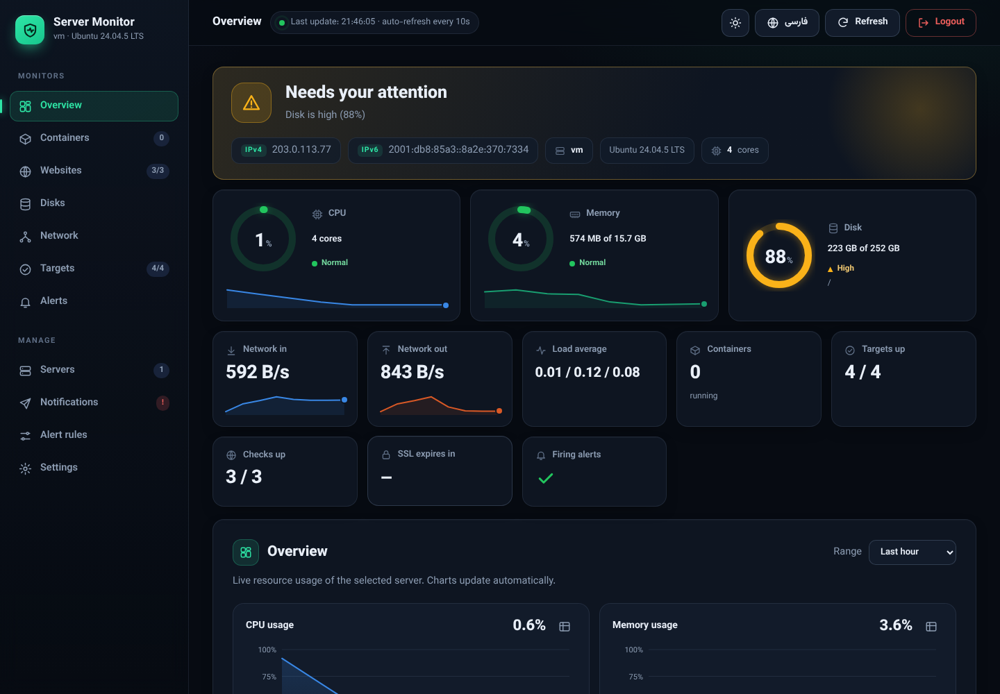
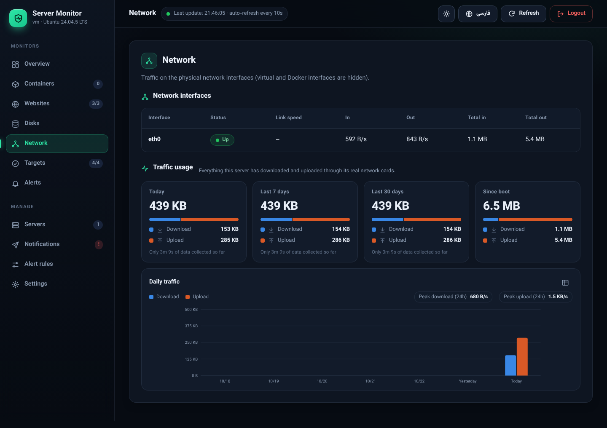
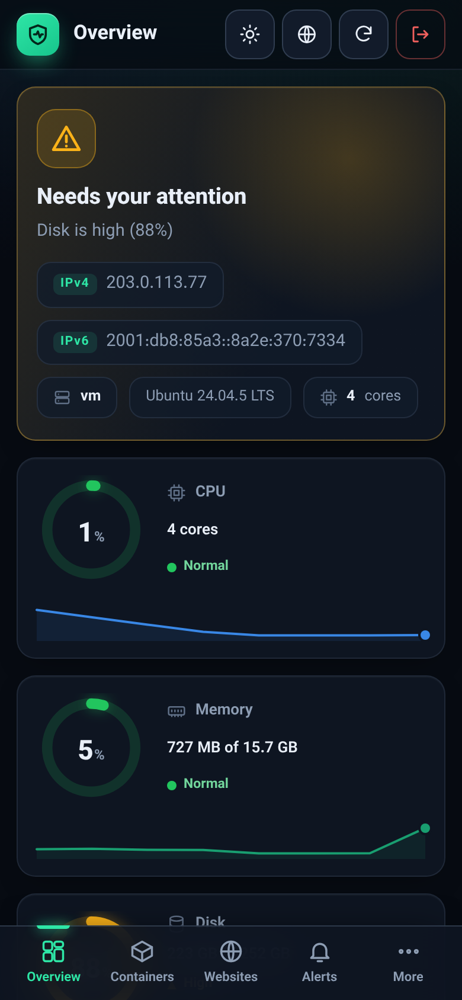
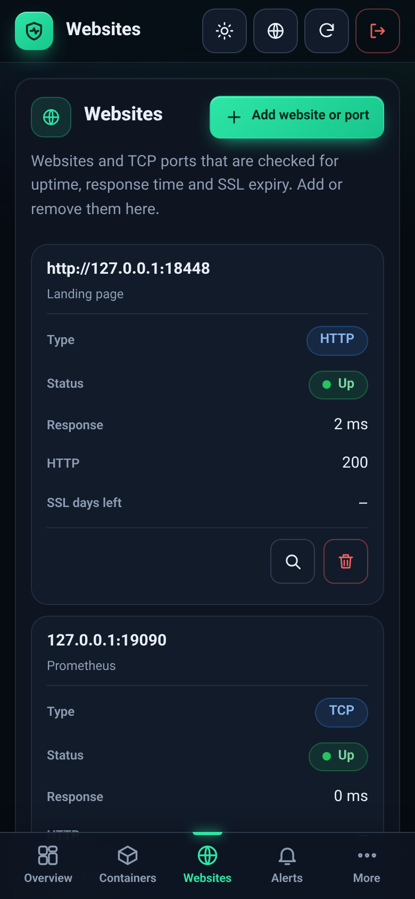
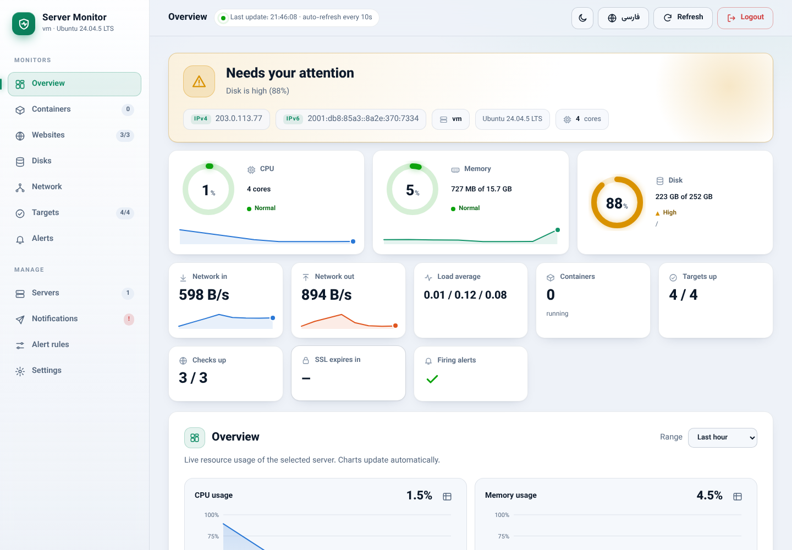

<div align="center">

# 🛰️ مانیتورینگ کامل سرور

**یک پنل وب شیک و فارسی برای دیدن حال سرور، سایت‌ها و کانتینرها و مدیریت همه‌چیز، بدون حتی یک بار رفتن به خط فرمان.**


<br>



</div>

<br>

## ✨ امکانات

<table>
<tr>
<td width="50%" valign="top">

### 📊 مانیتورینگ
- **وضعیت کلی** با یک نگاه: سالم / نیاز به توجه / مشکل
- **گیج‌های حلقه‌ای** CPU، رم و دیسک با رنگ شدت
- **نمودارهای تعاملی** با خط راهنما، تولتیپ و نمای جدولی
- **ترافیک شبکه** کامل: دانلود و آپلود امروز، ۷ و ۳۰ روز
- **آی‌پی عمومی** IPv4 و IPv6 سرور (با یک کلیک کپی)
- **کانتینرهای Docker** با مصرف CPU و رم

</td>
<td width="50%" valign="top">

### 🧰 مدیریت از پنل
- 🌐 افزودن و حذف **سایت** و **پورت TCP**
- 🖥️ افزودن **سرورهای دیگر**
- 📦 شروع، توقف، لاگ و **ساخت کانتینر**
- 🔔 اتصال **ربات تلگرام** و تست هشدار
- 🎚️ تغییر **آستانه‌ی هشدارها**
- 🔑 تغییر نام کاربری و رمز

</td>
</tr>
<tr>
<td width="50%" valign="top">

### 🩺 هوشمند
- 🔍 **«چرا این سایت خراب است؟»** با توضیح ساده
- 🪄 **رفع خودکار** سایتی که چک استاندارد را رد می‌کند
- ⏳ هشدار **انقضای SSL**
- 🚨 هشدار تلگرام برای CPU، رم، دیسک، سایت و کانتینر

</td>
<td width="50%" valign="top">

### 🎨 طراحی
- 🌗 تم **تیره و روشن**
- 🇮🇷 **فارسی (راست‌به‌چپ)** و 🇬🇧 انگلیسی، با فونت وزیرمتن
- 📱 **ریسپانسیو کامل**: دسکتاپ، تبلت، گوشی
- ♿ رنگ‌ها همیشه با شکل و برچسب همراه‌اند، نه فقط رنگ

</td>
</tr>
</table>

<br>

## 🚀 نصب در یک دقیقه

> **نیازمندی:** یک سرور لینوکسی و دسترسی root (یا sudo). اگر Docker نباشد، نصب‌کننده خودش نصبش می‌کند.

### ⚡ نصب یک‌خطی

```bash
curl -fsSL https://raw.githubusercontent.com/AmiRAliw24/desktop-tutorial/HEAD/install.sh | sudo bash
```

چند سؤال ساده می‌پرسد (نام کاربری و رمز پنل، آدرس listen، توکن تلگرام و سایت‌ها، همه اختیاری)، بعد پنل روی `http://IP-SERVER:3000` بالا می‌آید. 🎉

<details>
<summary><b>🤖 نصب بدون سؤال (برای اسکریپت و اتوماسیون)</b></summary>

<br>

به `env` دقت کنید تا متغیرها به sudo برسند:

```bash
curl -fsSL https://raw.githubusercontent.com/AmiRAliw24/desktop-tutorial/HEAD/install.sh \
  | sudo env PANEL_PASSWORD='...' SITES='https://a.com' bash -s -- -y
```

یا با فایل کپی‌شده روی سرور:

```bash
sudo env PANEL_PASSWORD='...' PANEL_BIND=0.0.0.0 \
     TELEGRAM_BOT_TOKEN='...' TELEGRAM_CHAT_ID='...' \
     SITES='https://a.com,https://b.org' bash install.sh -y
```

</details>

<details>
<summary><b>📁 نصب تک‌فایل (اگر ریپو private است)</b></summary>

<br>

فقط فایل `install.sh` را روی سرور کپی کنید و اجرا کنید:

```bash
scp install.sh root@SERVER:
ssh root@SERVER 'bash install.sh'
```

نصب‌کننده همه فایل‌ها را در `/opt/server-monitoring` می‌سازد و استک را بالا می‌آورد.

</details>

<details>
<summary><b>🎛️ گزینه‌های نصب‌کننده</b></summary>

<br>

| گزینه | کار |
|---|---|
| `-y` | بدون سؤال، با متغیرهای محیطی و پیش‌فرض‌ها |
| `--no-start` | فقط فایل‌ها را بنویس، کانتینری بالا نیاور |
| `--uninstall` | کانتینرها را حذف کن (داده‌ها می‌مانند) |
| `--purge` | کانتینرها، داده‌ها و پوشه‌ی نصب را کامل حذف کن |

</details>

> 💡 **اجرای دوباره‌ی `install.sh` امن است.** کد آپدیت می‌شود و پنل ری‌استارت می‌شود، ولی `.env` و هر چیزی که از پنل تنظیم کرده‌اید (سایت‌ها، سرورها، تلگرام، قوانین، رمز) دست‌نخورده می‌ماند. برای گرفتن نسخه‌ی جدید همین دستور را دوباره بزنید.

> ℹ️ `HEAD` در آدرس همیشه به برنچ پیش‌فرض ریپو اشاره می‌کند. گیت‌هاب فایل‌های raw را تا چند دقیقه کش می‌کند، پس بعد از هر آپدیت ممکن است چند دقیقه نسخه‌ی قبلی را بدهد.

<br>

## 🧭 پنل وب

آدرس: **`http://IP-SERVER:3000`** · ورود با `PANEL_USER` و `PANEL_PASSWORD` از `.env` (بعد از تغییر رمز در پنل، رمز جدید معتبر است).

### 📍 صفحه‌ها

| | صفحه | چه چیزی نشان می‌دهد |
|:-:|---|---|
| 🏠 | **نمای کلی** | وضعیت کلی، گیج‌ها، کارت‌های آماری، نمودارهای CPU، رم، شبکه و load |
| 📦 | **کانتینرها** | همه‌ی کانتینرها با وضعیت، CPU، رم، پورت و دکمه‌های مدیریت |
| 🌐 | **سایت‌ها** | آپتایم، زمان پاسخ، کد HTTP و انقضای SSL سایت‌ها و پورت‌ها |
| 💽 | **دیسک‌ها** | مصرف هر پارتیشن |
| 📡 | **شبکه** | کارت‌های شبکه و مصرف کامل آپلود/دانلود |
| 🎯 | **تارگت‌ها** | وضعیت منابعی که Prometheus از آن‌ها داده می‌گیرد |
| 🚨 | **هشدارها** | هشدارهای فعال و در انتظار |
| 🖥️ | **سرورها** | افزودن و حذف سرورهای دیگر |
| 🔔 | **اعلان‌ها** | اتصال و تست تلگرام |
| 🎚️ | **قوانین هشدار** | روشن/خاموش و تغییر آستانه‌ها |
| ⚙️ | **تنظیمات** | رمز، رفع خودکار، وضعیت کنترل داکر |

<div align="center">

<br><sub>📡 صفحه‌ی شبکه: کارت‌های شبکه، مصرف امروز / ۷ / ۳۰ روز / از زمان بوت و نمودار روزانه</sub>
</div>

<br>

### 🌐 سایت‌ها و پورت‌ها

افزودن و حذف سایت (HTTP/HTTPS) و پورت TCP برای چک آپتایم، زمان پاسخ و انقضای SSL.

- 🔍 **ذره‌بین کنار هر ردیف** چک را همان لحظه اجرا می‌کند و **دلیل ناموفق بودن** را به زبان ساده می‌گوید: قطع شدن handshake توسط سایت، پورت بسته، DNS، timeout، مشکل گواهی یا کد خطای HTTP.
- 🧪 برای سایتی که چک استاندارد را رد می‌کند، حالت‌های دیگر (TLS قدیمی ۱.۰/۱.۱، نادیده گرفتن خطای گواهی، HTTP ساده، فقط اتصال TCP) را هم امتحان می‌کند و می‌گوید کدام کار می‌کند. با **یک کلیک** همان حالت برای مانیتور آن سایت فعال می‌شود و کنار آدرس برچسب حالت دیده می‌شود.
- 🔀 اگر سایت فقط با HTTP ساده در دسترس باشد و HTTPS را برای این سرور رد کند، دکمه‌ی «مانیتور روی HTTP ساده» آدرس را (با حفظ نام) به `http://` تغییر می‌دهد.

<details>
<summary><b>🪄 رفع خودکار (پیش‌فرض روشن)</b></summary>

<br>

اگر سایتی که اضافه می‌کنید، یا سایتی که ۵ دقیقه خراب بوده، با چک استاندارد کار نکند، پنل خودش بهترین راه را پیدا و اعمال می‌کند:

1. حالت TLS دیگر
2. صفحه‌ای که آدرس `http://` سایت به آن ریدایرکت می‌شود
3. یا خود `http://`

✅ چکِ سالم **هرگز** تغییر نمی‌کند و سایتِ واقعاً خاموش دست‌نخورده می‌ماند.
📝 هر تغییر در بخش «Automatic adjustments» ثبت می‌شود و از **تنظیمات** قابل خاموش کردن است.

</details>

### 📡 ترافیک شبکه

زیر جدول کارت‌های شبکه، مصرف کامل آپلود و دانلود دیده می‌شود:

- 📅 **امروز** (به وقت مرورگر شما)، **۷ روز اخیر**، **۳۰ روز اخیر** و **از زمان بوت**
- 🟦🟧 نوار نسبت دانلود به آپلود در هر کارت
- ⚡ **اوج سرعت** ۲۴ ساعت اخیر
- 📊 **نمودار میله‌ای روزانه‌ی ۷ روز** با تولتیپ و نمای جدولی

آمار از Prometheus می‌آید و تا `PROMETHEUS_RETENTION` (پیش‌فرض ۳۰ روز) نگه داشته می‌شود. تا وقتی داده‌ی کافی جمع نشده، زیر هر کارت نوشته می‌شود چقدر داده وجود دارد.

### 🌍 آی‌پی عمومی

در کارت وضعیت کلی، **IPv4** و **IPv6** عمومی سرور نمایش داده می‌شود و با کلیک کپی می‌شود. یک کانتینر کوچک به نام `hostip` با شبکه‌ی خودِ سرور هر ۱۰ دقیقه آن را از `api.ipify.org` (و در صورت خطا `icanhazip.com` / `ident.me`) می‌پرسد. اگر سرور IPv6 ندارد «–» نشان داده می‌شود.

> 🔕 نمی‌خواهید به سایت بیرونی درخواست برود؟ در `.env` بنویسید `PUBLIC_IP_LOOKUP=0`.

### 🧰 مدیریت (همه از پنل)

| | بخش | کارها |
|:-:|---|---|
| 🖥️ | **سرورها** | افزودن و حذف سرورهای دیگر (با `node_exporter`)؛ دستور نصب روی سرور مقصد را همان‌جا می‌دهد |
| 📦 | **کانتینرها** | شروع، توقف، ری‌استارت، دیدن لاگ، حذف و **ساخت کانتینر جدید** (ایمیج، پورت، متغیر محیطی، ولیوم، سیاست ری‌استارت) |
| 🔔 | **اعلان‌ها** | اتصال ربات تلگرام (با دکمه‌ی «پیدا کردن Chat ID»)، پیام آزمایشی و هشدار آزمایشی |
| 🎚️ | **قوانین هشدار** | روشن/خاموش کردن هر قانون و تغییر آستانه و مدت پایداری (مثلاً CPU بالای ۷۰٪ به‌جای ۸۵٪)، با دکمه‌ی بازگشت به پیش‌فرض |
| ⚙️ | **تنظیمات** | تغییر نام کاربری و رمز، وضعیت کنترل داکر، رفع خودکار |

### 📱 روی گوشی و تبلت

<div align="center">

&nbsp;&nbsp;

&nbsp;&nbsp;

</div>

<br>

| صفحه | چیدمان |
|---|---|
| 🖥️ دسکتاپ (۱۱۰۰px به بالا) | سایدبار کامل |
| 📲 تبلت (۷۰۰ تا ۱۰۹۹px) | نوار آیکون |
| 📱 گوشی (زیر ۷۰۰px) | نوار تب پایین + منوی «بیشتر»؛ جدول‌ها به کارت و پنجره‌ها به باتم‌شیت تبدیل می‌شوند |

<br>

## 🧱 سرویس‌ها

| سرویس | کار |
|---|---|
| 🧭 **پنل وب** | داشبورد و مدیریت کامل (پورت 3000) |
| 📈 **Prometheus** | جمع‌آوری و ذخیره‌ی متریک‌ها (۳۰ روز) |
| 🚨 **Alertmanager** | ارسال هشدار به تلگرام |
| 🖥️ **node_exporter** | متریک‌های سیستم: CPU، رم، دیسک، load |
| 📡 **node-net** | آمار واقعی کارت‌های شبکه‌ی سرور |
| 📦 **cAdvisor** | متریک کانتینرهای Docker |
| 🌐 **Blackbox exporter** | چک آپتایم سایت‌ها، پورت‌ها و انقضای SSL |
| 🌍 **hostip** | پیدا کردن IPv4 / IPv6 عمومی سرور |

<br>

## 🔐 امنیت

> ⚠️ **مهم:** کنترل داکر یعنی دسترسی به `/var/run/docker.sock` و **هر کسی که وارد پنل شود در عمل روی کل سرور مدیر (root) است.** رمز قوی بگذارید و جلوی پنل HTTPS (مثلاً Caddy یا Nginx) قرار دهید؛ پنل روی HTTP ساده رمز را رمزنگاری نمی‌کند.

- 🔒 برای **فقط‌خواندنی** کردن لیست کانتینرها در `.env` بنویسید `PANEL_DOCKER_CONTROL=0` و `docker compose up -d` را بزنید.
- ⏱️ ورود اشتباه با **تأخیر یک‌ثانیه‌ای** رد می‌شود؛ کوکی نشست `HttpOnly` و `SameSite=Strict` است.
- 🛡️ همه‌ی عملیات تغییر (POST) هدر `X-Panel` و Origin درست می‌خواهند (محافظت CSRF).
- 👁️ داده‌ها را فقط‌خواندنی از Prometheus می‌گیرد؛ کوئری دلخواه از بیرون پذیرفته نمی‌شود.
- ✅ ورودی‌های ساخت کانتینر (ایمیج، پورت، env، ولیوم) سخت‌گیرانه اعتبارسنجی می‌شوند و پنل نمی‌تواند کانتینر خودش را متوقف یا حذف کند.
- 🧱 پورت پنل باید در فایروال سرور و پنل هاستینگ باز باشد. Prometheus و Alertmanager فقط روی `127.0.0.1` باز می‌شوند.
- 🔗 اگر پنل را روی `127.0.0.1` گذاشتید، از کامپیوتر خودتان با `ssh -L 3000:127.0.0.1:3000 root@SERVER` وصل شوید.

<details>
<summary><b>🔑 رمز را فراموش کرده‌اید؟</b></summary>

<br>

```bash
cd /opt/server-monitoring
rm data/panel/auth.json && docker compose restart panel
```

رمز به مقدار `PANEL_PASSWORD` در `.env` برمی‌گردد.

</details>

<br>

## 🎛️ تنظیمات

### 🧾 متغیرهای `.env`

| متغیر | پیش‌فرض | توضیح |
|---|---|---|
| `PANEL_USER` / `PANEL_PASSWORD` | `admin` / (الزامی) | ورود به پنل |
| `PANEL_PORT` | `3000` | پورت پنل (اگر اشغال باشد نصب‌کننده پورت آزاد پیدا می‌کند) |
| `PANEL_BIND` | `0.0.0.0` | آدرس listen؛ برای فقط‌محلی `127.0.0.1` |
| `PANEL_DOCKER_CONTROL` | `1` | `0` یعنی کانتینرها فقط‌خواندنی |
| `TELEGRAM_BOT_TOKEN` / `TELEGRAM_CHAT_ID` | خالی | اتصال اولیه‌ی تلگرام (بعداً از صفحه‌ی اعلان‌ها هم می‌شود) |
| `PROMETHEUS_RETENTION` | `30d` | مدت نگهداری داده‌ها |
| `PUBLIC_IP_LOOKUP` | `1` | `0` یعنی نمایش آی‌پی عمومی خاموش |
| `DOCKER_GID` | خودکار | گروه صاحب `docker.sock` (نصب‌کننده پر می‌کند) |

> همه‌ی تنظیمات کاربری (سایت‌ها، سرورها، تلگرام، قوانین، رمز) را از خود پنل عوض کنید؛ `.env` فقط برای مقدارهای پایه است.

<details>
<summary><b>📂 فایل‌های تنظیمات (فقط وقتی پنل در دسترس نیست)</b></summary>

<br>

فایل‌ها را خود پنل می‌نویسد؛ دستی فقط وقتی ویرایش کنید که پنل در دسترس نیست:

- `prometheus/targets/{http,tcp,nodes}.json`: سایت‌ها، پورت‌ها و سرورها (قالب `file_sd` پرومتئوس؛ بعد از ذخیره خودکار اعمال می‌شود).
- `prometheus/rules/alerts.yml` و `alertmanager/alertmanager.yml`: از روی تنظیمات پنل تولید می‌شوند و ویرایش دستی‌شان بازنویسی می‌شود.
- `data/panel/settings.json`: توکن تلگرام و تنظیمات قوانین (مجوز 0600).

</details>

<details>
<summary><b>➕ اضافه کردن سرور دوم</b></summary>

<br>

1. روی آن سرور `node_exporter` اجرا کنید.
2. پورت `9100` را **فقط برای IP سرور مانیتورینگ** باز کنید.
3. در پنل، صفحه‌ی **سرورها** را باز کنید و آدرس را اضافه کنید. دستور نصب همان‌جا نوشته شده است.

</details>

<details>
<summary><b>🧑‍🔧 راه‌اندازی دستی (بدون نصب‌کننده)</b></summary>

<br>

```bash
cp .env.example .env                 # رمز پنل را بنویسید
echo "DOCKER_GID=$(stat -c %g /var/run/docker.sock)" >> .env
./scripts/render-config.sh           # پوشه‌ها، تنظیم اولیه‌ی Alertmanager و مجوزها (با sudo اجرا کنید)
docker compose up -d
```

- پنل وب: http://localhost:3000
- Prometheus: http://localhost:9090
- Alertmanager: http://localhost:9093

</details>

<br>

## 🔧 عیب‌یابی

<details>
<summary><b>📡 جدول شبکه خالی است</b></summary>

<br>

`node_exporter` داخل کانتینر فقط شبکه‌ی خود کانتینر را می‌بیند، نه کارت‌های واقعی سرور. به همین دلیل سرویس جدای `node-net` (همان `node_exporter` با `privileged` و خواندن از `/proc/1`، یعنی namespace شبکه‌ی خود سرور) آمار واقعی کارت‌ها (مثل `eth0`) را می‌دهد و `node_exporter` اصلی آمار شبکه را نمی‌دهد تا دوبار شمرده نشود. پنل بالای جدول دلیل خالی بودن را می‌نویسد؛ برای جزئیات:

```bash
docker compose logs --tail 20 node-net
```

</details>

<details>
<summary><b>💾 پنل نمی‌تواند تنظیمات را ذخیره کند</b></summary>

<br>

پنل با کاربر `65534` اجرا می‌شود و باید روی این پوشه‌ها بنویسد. نصب‌کننده خودش مجوزها را درست می‌کند؛ دستی:

```bash
cd /opt/server-monitoring
sudo chown -R 65534:65534 data prometheus/targets prometheus/rules alertmanager
docker compose restart panel
```

</details>

<details>
<summary><b>🔌 نصب‌کننده با خطای 404 جواب می‌دهد</b></summary>

<br>

ریپو باید **public** باشد. اگر private است، فایل `install.sh` را با `scp` روی سرور کپی کنید و اجرا کنید.

</details>

<details>
<summary><b>⬆️ ارتقا از نسخه‌ی قدیمی</b></summary>

<br>

فقط `install.sh` را دوباره اجرا کنید:

- لاگین قدیمی (`GRAFANA_ADMIN_*`) به `PANEL_*` منتقل می‌شود.
- کانتینر Grafana حذف می‌شود.
- فایل‌های قدیمی سایت‌ها و سرورها (`prometheus/targets/*.yml`) خودکار به قالب جدید (`*.json`) مهاجرت می‌کنند (فایل قدیمی به `.migrated` تغییر نام می‌دهد).
- اگر قبلاً تلگرام را در `.env` گذاشته بودید، به پنل منتقل می‌شود.

داده‌های قدیمی Grafana روی دیسک می‌مانند؛ اگر لازم ندارید: `docker volume rm server-monitoring_grafana_data`.

</details>

<br>

## 🧑‍💻 برای توسعه‌دهنده‌ها

`install.sh` از روی فایل‌های همین ریپو ساخته می‌شود. بعد از تغییر هر فایل:

```bash
./scripts/build-installer.sh
```

```
.
├── docker-compose.yml        # کل استک
├── install.sh                # نصب‌کننده‌ی تک‌فایل (تولیدشده)
├── panel/                    # پنل وب (پایتون + HTML/CSS/JS ساده، بدون وابستگی)
│   ├── server.py             #   مسیرها، احراز هویت، امنیت
│   ├── store.py              #   سایت‌ها، سرورها، تلگرام، قوانین، رفع خودکار
│   ├── monitor.py            #   کوئری‌های فقط‌خواندنی Prometheus
│   ├── hostip.py             #   پیدا کردن آی‌پی عمومی
│   └── static/               #   رابط کاربری
├── prometheus/ blackbox/     # تنظیمات
├── scripts/                  # ساخت نصب‌کننده و ابزارها
└── docs/screenshots/         # تصاویر این صفحه
```

<br>

<div align="center">

با ❤️ برای کسی که می‌خواهد سرورش را بدون دردسر ببیند و مدیریت کند.

</div>
